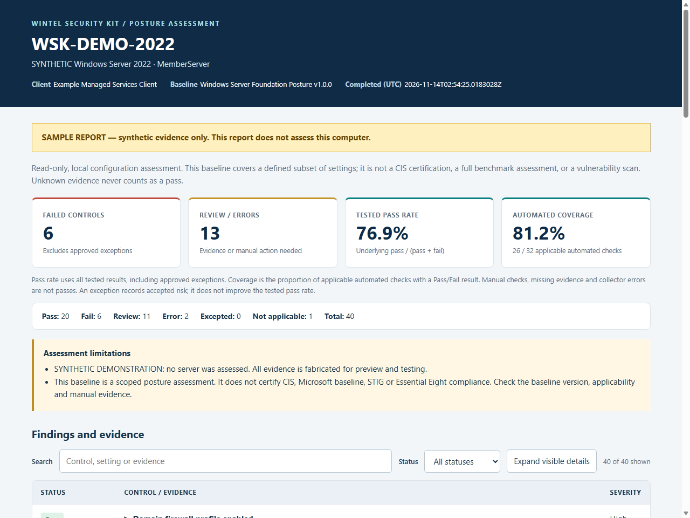

# Wintel Security Kit 0.1.1

A portable PowerShell application for read-only, local Windows Server posture assessment. It provides a Windows Forms interface, command line and self-contained HTML/JSON/CSV reports. No external libraries, installers or internet access are required at runtime.

**See what a scan produces:** [Sample findings and output guide](Samples/Demo/README.md) · [Console transcript](Samples/Demo/CONSOLE.txt) · [CSV](Samples/Demo/SecurityAssessment.csv) · [JSON](Samples/Demo/SecurityAssessment.json). To try the interactive report, extract [the portable kit](Dist/WintelSecurityKit-0.1.1.zip) and open `Samples\Demo\SecurityAssessment.html` in your browser.

| Synthetic Server 2022 member server | Pass | Fail | Review | Error | Excepted | Not applicable |
| --- | ---: | ---: | ---: | ---: | ---: | ---: |
| Windows Server Foundation · 40 controls | 20 | 6 | 11 | 2 | 0 | 1 |

[](Samples/Demo/README.md)

The bundled foundation profile includes **32 automated checks and 8 manual evidence prompts**. It is an original, documented settings profile, not a complete CIS benchmark, Microsoft baseline, STIG assessment or Essential Eight maturity assessment. See [sources and policy choices](Docs/SOURCES.md) and the included [synthetic sample report](Samples/Demo/SecurityAssessment.html).

For a comparison with published Microsoft values, select `Baselines\microsoft-windows-server-subset.v1.json` in the GUI's **Baseline JSON** field or pass its path to the CLI. This profile checks selected settings from Microsoft's Azure compute security baseline. The [mapping notes](Docs/MICROSOFT-SUBSET.md) identify the source and scope of each setting.

## Start here

1. Extract the complete kit folder to a local directory on the target server.
2. Review the source and baseline through your normal software approval process. The package is source code and is not Authenticode-signed; use your organisation's trusted signing and script execution policy.
3. Open **64-bit Windows PowerShell 5.1**, as administrator for fuller evidence collection, and change to the extracted folder.
4. Run `Start-WintelSecurityGui.ps1` or `Launch-GUI.cmd`. Choose **Load sample**, then **Open HTML report** for the bundled synthetic example. Choose **Run assessment** for a live scan on the supported server where the GUI is running.

```powershell
.\Start-WintelSecurityGui.ps1

# Synthetic preview; no host evidence collected. Also works on a workstation.
.\Invoke-WintelSecurityAssessment.ps1 -Demo -ClientName 'Example client'

# Assess the server on which this command is running.
.\Invoke-WintelSecurityAssessment.ps1 -ClientName 'Client / site' -OutputDirectory 'D:\SecurityReports'

# Compare local evidence against the included Microsoft baseline subset.
.\Invoke-WintelSecurityAssessment.ps1 -BaselinePath '.\Baselines\microsoft-windows-server-subset.v1.json'

# Use a reviewed customer profile and approved exceptions.
.\Invoke-WintelSecurityAssessment.ps1 -BaselinePath '.\Baselines\customer.json' -ExceptionsPath '.\client-exceptions.json'
```

If the GUI opens but the assessment immediately reports **AuthorizationManager check failed**, [diagnose the startup failure](Docs/STARTUP.md). The bundled sample can be viewed directly in a browser. A live run starts a separate PowerShell process and loads the runner and modules under Windows policy.

The launcher does not elevate itself or bypass execution policy. If Windows blocks scripts, arrange approved signing/execution policy with your endpoint administrators. Group Policy, application control, constrained language mode and downloaded-file restrictions can also prevent execution. Do not weaken server controls to run this kit.

## Supported environment

| Component | Scope |
| --- | --- |
| Servers | Windows Server 2019 / 2022 / 2025, builds 17763 / 20348 / 26100 |
| Roles | Member server, standalone server, domain controller |
| Runtime | 64-bit Windows PowerShell 5.1; PowerShell 7 is not a supported live collector host |
| Interface | Windows Forms on Desktop Experience; CLI on Server Core |
| Dependencies | Built-in .NET and Windows tools; no downloads or external network calls |
| Access | Elevated local session recommended; restricted access becomes Review/Error |
| Scope | Local server only; remote orchestration is outside this version |

Optional components such as Defender and BitLocker may be absent. Missing providers/settings are not inferred to be secure. Approved alternative protection needs separate evidence and customer interpretation.

## Assessment coverage

- Firewall profile/default inbound configuration, SMB signing, insecure guest access and SMB1 server configuration.
- Defender-specific health and intelligence age; OS-volume BitLocker protection and full encryption.
- Local-account password and lockout policy on member and standalone servers.
- Explicit UAC, legacy authentication, WDigest, PowerShell logging, inactivity, installer, audit-precedence and LLMNR settings.
- Manual prompts for MFA, protected backups and recovery, patch/vulnerability management, application control, effective domain policy, alternate endpoint security, DC LDAP security and remote-access exposure.
- Expiring, host-specific exceptions with reason, accountable owner and ticket.

Domain controllers exclude local-account policy checks. Effective domain and fine-grained password policies remain manual; a local export cannot prove every user's resultant policy.

## Results and scoring

| Status | Meaning |
| --- | --- |
| Pass | Collected evidence meets this specific setting |
| Fail | Collected evidence does not meet the setting |
| Review | Manual decision, missing value, provider or evidence |
| Error | Collection, evidence-type or evaluation failure |
| NotApplicable | Outside the declared server release or role |
| Excepted | A confirmed failure has a matching, unexpired approved exception |

**Tested pass rate** = underlying passes / (underlying passes + underlying failures). Exceptions never improve it. **Automated coverage** = automated checks with Pass/Fail evidence / applicable automated checks. Manual reviews are excluded from automated coverage and remain visible. No evaluated checks means a null pass rate, not 100%.

This is a simple control count, not a risk score or official compliance percentage. A registry policy proves stored configuration, not runtime enforcement, completed restart, network reachability or application compatibility. A successful subset cannot establish overall security.

Each scan creates a unique folder with `SecurityAssessment.html`, `.json` and `.csv`. HTML supports offline search, status filters and expandable evidence. CSV text is protected against common spreadsheet formula injection. JSON retains typed evidence for integrations. Timestamps are UTC.

## Exceptions and manual evidence

Copy `Samples\exceptions.example.json` and replace all placeholders. Every entry must match the exact computer name, baseline ID, baseline version and control ID. Wildcards are rejected. `ExpiresOn` is valid through that UTC date. Expired or mismatched entries are ignored with a warning. Only confirmed failures can be excepted; unknown evidence cannot become a pass. The kit records supplied approval information; it does not authenticate the approver or ticket.

Manual checks remain Review. Record their assessment and evidence in your service-management or GRC system; this release does not write manual decisions back into a report.

## CLI exit codes

| Code | Meaning |
| --- | --- |
| 0 | No failed, incomplete or excepted controls; at least one evaluated check |
| 1 | Report generated with unexcepted failures; may also have Review/Error |
| 2 | Run could not complete: invalid input, unsupported OS or output failure |
| 3 | Report generated with Review/Error/Excepted, or no evaluated checks, and no unexcepted failures |

Read the JSON summary for full detail. The foundation profile intentionally includes manual checks, so runs normally return 1 or 3. A nonzero code is not necessarily a crash.

## Data handling

Collection reads configuration only. It does not remediate, alter GPO/registry/firewall, enable services, install modules, upload reports or probe remote systems. `secedit /export /mergedpolicy` creates a temporary local-account policy export and log, then removes its owned directory. Reports, test artifacts and package artifacts are other deliberate file writes. Interrupted processes may leave `WintelSecurityKit-<guid>` directories in the session temp folder; treat them as configuration evidence and remove through normal housekeeping.

Reports contain host identity and security configuration. Use an access-controlled customer location and your normal retention process. The kit does not collect credentials or BitLocker recovery keys. Remediation text requires normal change review and compatibility testing.

## Formal baselines and extension

[BASELINE-FORMAT.md](Docs/BASELINE-FORMAT.md) documents custom profiles and collectors. Custom JSON contains data, not executable expressions. Unknown fact names remain Review; unsupported checks need a reviewed collector enhancement or manual control.

For formal CIS work, obtain the exact licensed benchmark/version for each role and release, confirm permitted managed-service use and create a complete reviewed mapping. No CIS benchmark text, commercial licence or assessor certification is included. Microsoft SCT/OSConfig and Essential Eight references are linked in the source notes.

## Verification and packaging

```powershell
.\Tests\Test-Kit.ps1
.\Tests\Test-Collectors.ps1
.\Tests\Test-Gui.ps1
.\Build-Kit.ps1
```

Tests use synthetic evidence and mocks, not a live host assessment. Coverage includes schema rejection, typed evaluation, role applicability, exceptions, missing evidence, collectors, report escaping and GUI/process behavior.

Build-Kit creates `Dist\WintelSecurityKit-0.1.1.zip`, its SHA-256 sidecar and `SHA256SUMS.txt`. It excludes live reports and test output. Hashes detect alteration; they are not a publisher signature.

**Validation boundary:** PowerShell 5.1 synthetic and mocked tests have run on a Windows workstation. Live pilot validation remains necessary on representative Server 2019/2022/2025 member servers and domain controllers, including Server Core. Follow [PILOT-ACCEPTANCE.md](Docs/PILOT-ACCEPTANCE.md).
