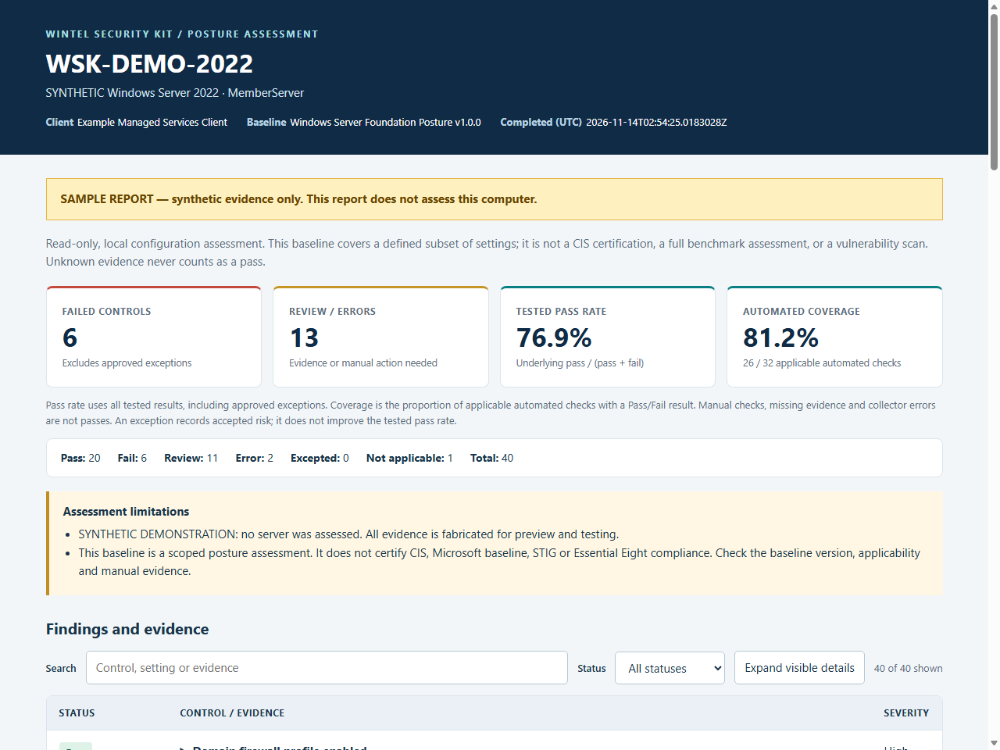

# Sample assessment output

**Open [SecurityAssessment.html](SecurityAssessment.html) in a browser after extracting the ZIP.** It works offline before you run PowerShell. On GitHub, use the tables below to preview the findings. All values come from one synthetic Windows Server 2022 member-server scan, using the Windows Server Foundation Posture profile v1.0.0.

| What you want to see | File | What to look for |
| --- | --- | --- |
| The operator's report | [HTML report](SecurityAssessment.html) | Filter by status. Expand a control to see its expected setting, observed value, evidence and suggested action. |
| The worklist | [CSV export](SecurityAssessment.csv) | One row per control. Filter the Status column to Fail when preparing remediation tickets. |
| The integration output | [JSON export](SecurityAssessment.json) | Context identifies the host and role. Summary contains counts and rates. Results contains each control and its evidence. |
| What the command printed | [Console transcript](CONSOLE.txt) | Command, counts, report paths and exit code. The output root is displayed as a relative path. |

## What the operator sees



| Host | Baseline controls | Pass | Fail | Review | Error | Excepted | Not applicable |
| --- | ---: | ---: | ---: | ---: | ---: | ---: | ---: |
| WSK-DEMO-2022 | 40 | 20 | 6 | 11 | 2 | 0 | 1 |

The **tested pass rate is 76.9%** because 20 of the 26 controls with a definite result passed. **Automated coverage is 81.2%** because 26 of 32 applicable automated controls returned a definite result. The 11 Review findings include seven manual evidence requests and four automated checks with missing evidence. The domain-controller LDAP check is outside this member server's scope.

## Four findings from this run

| Control | Status | Evidence | Operator action |
| --- | --- | --- | --- |
| WSK-005 · Public firewall profile enabled | **Fail** | Expected Enabled. The sample returned `false`. | Review the effective public-profile firewall policy and raise a change if needed. |
| WSK-007 · SMB server SMB1 protocol disabled | **Review** | The sample supplied no SMB1 server setting. | Obtain the configuration before deciding whether SMB1 is enabled. |
| WSK-011 · Defender-specific antivirus active | **Error** | The simulated collector failed before returning a value. | Investigate collection. Where another product is approved, review its health evidence under WSK-106. |
| WSK-101 · Verify MFA and privileged access coverage | **Review** | The assessment requires evidence from the identity and remote-access systems. | Record the assessor's decision and evidence in the client's review record. |

The CLI returned **exit code 1** because it found six unexcepted failures. It wrote all three reports to the folder shown in the [transcript](CONSOLE.txt). The files beside this guide are copies from that run. The last eight characters of the folder name are the first eight characters of the JSON `RunId`.

## Reproduce the example

In the GUI, choose **Load sample**, then **Open HTML report** to view these existing files. The shipped example was generated with kit 0.1.0. To generate a fresh example with the current kit, run this command from the extracted directory:

```powershell
.\Invoke-WintelSecurityAssessment.ps1 -Demo -DemoRelease 2022 -DemoRole MemberServer -ClientName 'Example Managed Services Client' -OutputDirectory .\Reports
```

Each run creates a new timestamped folder. The host and readings in demo mode are synthetic. A live assessment reports the target server's own identity, evidence and results.
